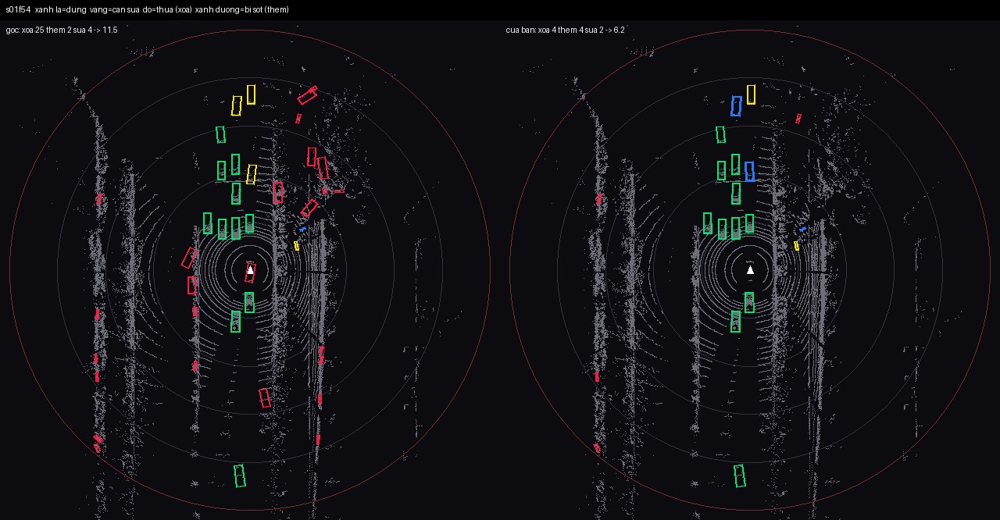

# Báo cáo Day 14 — Tran Gia Huy — 2A202603049

- Mã học viên dùng với `--student`: `049`
- `seed_tag` trong `frames_A.txt`: `393590736f`

## 1. Dự đoán trước sweep (bước 5b)

Ghi **trước** khi chạy `scripts/pp_sweep.py`, rồi commit và push ngay (lịch sử commit là bằng chứng thời điểm viết). Không sửa phần này sau khi có kết quả.

- Tham số tôi nghĩ giảm công sửa nhiều nhất: 0.3
- Vì sao (nhìn ảnh BEV tập A: box thừa nhiều hay box sót nhiều?): Qua 3 ảnh BEV tập A và số đo gốc (dự đoán 99 box nhưng GT chỉ có 41 box, phải xóa 63 box thừa trong khi chỉ thêm 5 box sót), phần lớn chi phí sửa đến từ việc xóa các box dự đoán thừa.Vì vậy tôi dự đoán tăng ngưỡng lọc sẽ loại bớt các box thừa này mà ít làm tăng số box bị sót.

## 2. Tập A: sửa tay và tune

| Cấu hình | Xóa | Thêm | Sửa | Chi phí |
|---|---:|---:|---:|---:|
| Gốc | 63 | 5 | 5 | 26.4 |
| `best_config.json` | 11 | 11 | 2 | 15.3 |

- Tham số đã đổi trong `best_config.json`: `score_thr: 0.1 -> 0.5`, `min_points: 0 -> 10`
- Kết quả leave-one-out (dán các dòng `scripts/pp_sweep.py` in ra):
  ```text
  s01f54: cấu hình chọn {'score_thr': '0.5', 'min_points': '10'} → 6.2 (tốt nhất có thể 6.2)
  s02f01: cấu hình chọn {'score_thr': '0.5', 'min_points': '10'} → 3.9 (tốt nhất có thể 3.4)
  s05f16: cấu hình chọn {'score_thr': '0.5', 'min_points': '10'} → 5.2 (tốt nhất có thể 5.2)
  ```
- Cấu hình có ổn định trên từng frame không? Vì sao tôi vẫn chọn (hoặc không chọn) nó: Cấu hình score_thr=0.5, min_points=10 được chọn ở cả 3 lượt leave-one-out. Hai frame s01f54 (6.2) và s05f16 (5.2) đạt đúng mức tốt nhất có thể (oracle). Frame s02f01 đạt 3.9 so với oracle 3.4, chỉ lệch 0.5. Cấu hình này không phụ thuộc vào việc bỏ frame nào, và chi phí khi kiểm tra trên frame chưa thấy luôn sát oracle. Vì vậy tôi chọn nó. Tôi vẫn thận trọng vì chỉ có 3 frame tune. Ngoài ra, cấu hình này nằm ở mép lưới (0.5 là mức cao nhất, 10 là mức cao nhất của min_points), nên có thể mức tối ưu thật còn cao hơn mà tôi chưa thử.

## 3. Trước/sau (bước 8)



- `scripts/pp_compare.py` báo giảm 42% công sửa trên tập A (từ 26.4 xuống 15.3).
- Dự đoán ở mục 1 đúng hay sai? Giải thích bằng số box xóa/thêm/sửa: Dự đoán đúng hướng nhưng lệch giá trị: tôi đoán 0.3 (chi phí 21.6 / 20.7), còn tối ưu thực tế là score_thr=0.5, min_points=10 (15.3); dù số box thêm tăng từ 5 lên 11 (+6.0 điểm), xóa giảm 63 → 11 (−15.6) và sửa giảm 5 → 2 (−1.5) nên tổng chi phí giảm ròng 11.1 điểm (42%).

## 4. Tập B

Số đo từ `scripts/pp_prelabel.py --frames d14_049/frames_B.txt --config d14_049/best_config.json --gt d14_049/ref_B.json`:

| Xóa | Thêm | Sửa | Chi phí |
|---:|---:|---:|---:|
| 46 | 23 | 26 | 49.8 |

- Loại box tốn công sửa nhất ở tập B: Car tốn nhất: khoảng 22 xóa, 6 thêm và 26 sửa (≈ 0.3·22 + 6 + 0.5·26 ≈ 25.6 điểm).

## 5. Giới hạn

- Nêu ít nhất 2 giới hạn (ví dụ: chỉ 3 frame tune; model KITTI không có Truck/Bus; chi phí là công thức, chưa phải thời gian sửa thật): 
    + Chỉ tune trên 3 frame tập A. Leave-one-out cho thấy cấu hình khá ổn định, nhưng mẫu quá nhỏ và best nằm ở mép lưới (0.5, 10), nên có thể chưa phải tối ưu thật.

    + Mức giảm 42% chỉ đo trên tập A (cũng là tập dùng để chọn cấu hình, nên có thiên lệch lạc quan). Ở tập B tôi không chạy cấu hình gốc để so sánh, nên không kết luận được mức giảm trên B.

    + Model được huấn luyện trên KITTI (LiDAR 64 tia, chỉ 3 lớp), không có lớp Truck/Bus và dễ bỏ sót Pedestrian/Cyclist. Việc tăng score_thr và min_points làm tăng số box bị sót (5 → 11 ở tập A).

    + Chi phí 0.3·xóa + 1.0·thêm + 0.5·sửa chỉ là công thức trọng số, chưa phải thời gian sửa thật, nên không thể nói là "tiết kiệm X giờ công". 
